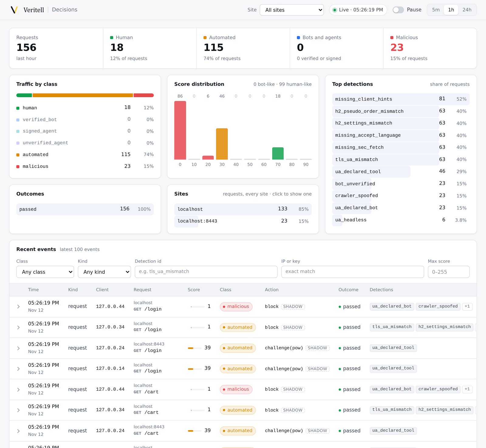
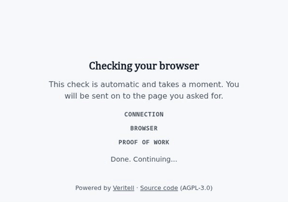

<h1>
  <picture>
    <source media="(prefers-color-scheme: dark)" srcset="docs/media/veritell-mark-dark.svg">
    
  </picture>
  Veritell
</h1>

A self-hosted bot detection gateway. It sits in front of your site,
terminates TLS, and scores every visitor from the TLS and HTTP/2 handshake,
the TCP SYN, a small browser probe and behaviour. It answers with a graduated
response instead of a wall: pass, a silent check, a proof of work, or a block.
There's no CAPTCHA, and nothing leaves your server.

The core idea is **cross-layer consistency**. A request makes claims at every
layer: the User-Agent claims a browser and OS, the handshake reveals the
network stack, the SYN reveals the kernel, and the JavaScript environment
reveals the engine. Real devices come in a limited number of coherent
combinations. Evasion tools fix one layer at a time, so they produce
combinations that don't exist in the wild.

<picture>
  <source media="(prefers-color-scheme: dark)" srcset="docs/media/dashboard-dark.png">
  
</picture>

*The dashboard in shadow mode, with synthetic traffic from local tools: a
browser, curl and Python saying what they are, curl claiming to be Chrome
(the handshake gives it away), a fake Googlebot and a scraper. Every action
is what the gateway would do; in shadow mode it lets everything through.*

## Status

Pre-release. The gateway runs in **shadow mode** on real sites: it scores and
logs everything and blocks nothing, while the thresholds for acting are set
from real traffic. Don't turn on blocking without your own review.

## Try it

You need one Linux server where TLS ends (no CDN proxy in front), Docker, and
SSH access. The rollout kit installs the gateway in shadow mode, and you can
roll back with one command:

```bash
cd deploy
cp site.conf.example site.conf   # pick FRONT=redirect, port or compose
./install.sh                     # nothing public changes yet
./cutover.sh                     # the gateway goes in front, in shadow
./rollback.sh                    # back to how it was
```

[deploy/README.md](deploy/README.md) explains the modes, updates, the
weekly report and uninstalling.

To build the gateway alone:

```bash
cargo build --release -p veritell-proxy   # binary: target/release/veritell
```

or `docker build -t veritell .`.

## What a challenged visitor sees

Most visitors never see a challenge. When a policy asks for one, the page
checks the browser and runs a small proof of work, then sends the visitor
on, usually within two seconds:

<picture>
  <source media="(prefers-color-scheme: dark)" srcset="docs/media/challenge-dark.gif">
  
</picture>

No images, fonts or third-party scripts: the page is plain HTML and CSS
served by the gateway, and it holds still for visitors who ask for reduced
motion.

## Layout

| Path | What |
|---|---|
| `crates/veritell-proxy` | The gateway (Pingora based) |
| `crates/veritell-fp`, `-ua`, `-probe`, `-behavior` | Network fingerprints, User-Agent parsing, the browser probe, behaviour signals |
| `crates/veritell-policy`, `-model`, `-quota` | YAML and CEL policy, a tree-ensemble model, rates and quotas per identity |
| `crates/veritell-token`, `-privacypass`, `-wba`, `-directory` | Challenges, Private Access Tokens, Web Bot Auth |
| `crates/veritell-events`, `-agg`, `-dash` | Event store (ClickHouse), the population layer, dashboard |
| `crates/veritell-core`, `-identity`, `-probe-build` | Shared types (classes, detections), crawler verification and network class, the per-build sealed probe |
| `crates/veritell-feed`, `-share`, `-persist` | Signed rule bundles, hash sharing between installs, state files that survive a restart |
| `probe/` | The probe and behaviour scripts injected into pages |
| `deploy/` | The rollout kit |
| `lab/` | Bot clients used to test detection |

## Licence

[AGPL-3.0-only](LICENSE). If you run a modified version for others over a
network, you must offer them its source (section 13): the gateway's own
pages link to the source, so point `--source-url` at your version's. Contributions need a
CLA, see [CONTRIBUTING.md](CONTRIBUTING.md).
